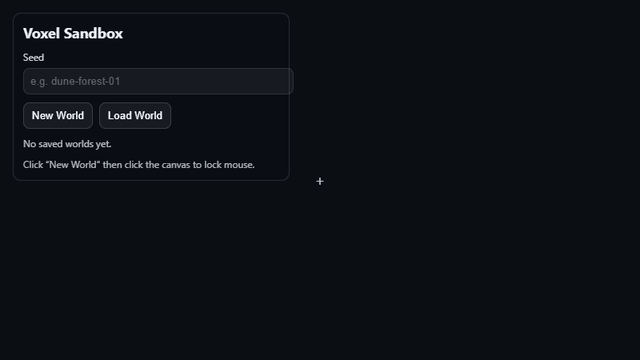
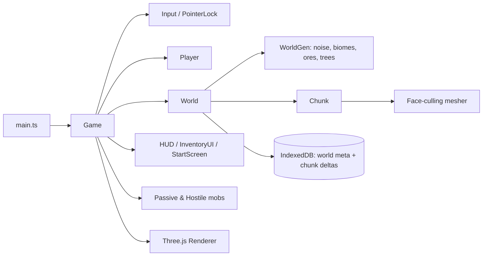
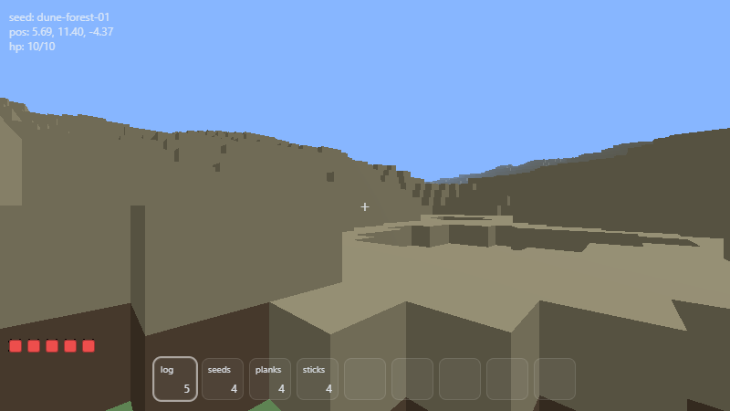
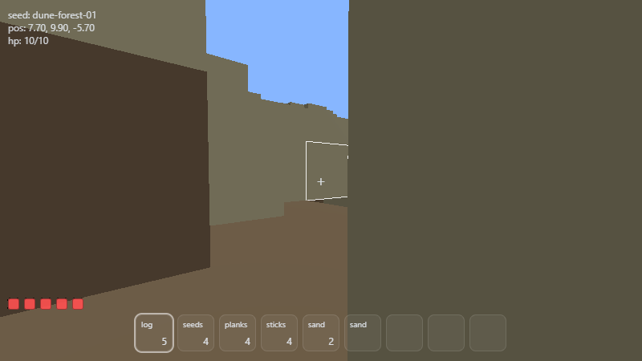

# Voxel Sandbox

A Minecraft-style voxel sandbox that runs entirely in the browser: procedurally generated chunked terrain, mining and building, farming, simple crafting, mobs and persistent saves, built with TypeScript, Three.js and Vite.




*Real gameplay captured from this build in headless Chromium (software WebGL): walking, jumping, mining blocks and opening the inventory.*

## Features

- **Procedural world** from a text seed: multi-octave simplex-noise heightmap, three biomes (plains, forest, desert), ore veins (coal/iron) and trees. The same seed always gives the same world.
- **Chunked streaming**: 16x64x16 chunks loaded in a radius around the player and unloaded when far away; meshes are rebuilt only for dirty chunks.
- **Face-culling mesher** that emits only exposed block faces, with per-face vertex colours.
- **First-person controls** with pointer lock, AABB collision, gravity, jumping and sprinting.
- **Mining and building** using a DDA voxel raycast and a target highlight box; broken blocks drop collectable items.
- **Inventory, hotbar and crafting** (planks, sticks, wooden pickaxe, hoe).
- **Farming**: till dirt with the hoe, plant seeds, crops grow through four stages on a deterministic seeded random tick.
- **Mobs**: passive wanderers and hostile mobs that chase the player at night.
- **Persistence**: only edited blocks are stored as per-chunk deltas in IndexedDB, together with player state, inventory and world time (press `K` to save, `beforeunload` also saves).

## Tech stack

TypeScript, Three.js (WebGL), Vite, `simplex-noise` and `alea` for seeded noise, IndexedDB for storage.

## Architecture



## Getting started

Requires Node.js 18+.

```bash
npm install
npm run dev        # development server (Vite)
npm run build      # type-check + production build
npm run preview    # serve the production build
```

Open the printed local URL, type an optional seed, click **New World**, then click the canvas to capture the mouse.

### Controls

| Input | Action |
| --- | --- |
| `W` `A` `S` `D` | Move |
| `Space` / `Shift` | Jump / sprint |
| Mouse | Look |
| Left click (hold) | Attack mob or break block |
| Right click | Place block / till with hoe / plant seeds |
| Mouse wheel | Change hotbar slot |
| `E` | Inventory and crafting |
| `K` | Save world |

## Screenshots

| Start screen | Terrain | Inventory |
| --- | --- | --- |
|  |  |  |

## Project structure

```
src/
  engine/     Game loop, input, renderer, time
  world/      World, Chunk, generation/, meshing/, storage/ (IndexedDB + delta codec)
  entities/   Player, item drops, mobs/
  data/       Block, item and recipe definitions
  ui/         HUD, inventory/crafting UI, start screen
  utils/      AABB, hashing, RNG, voxel raycast
```

## Notes and roadmap

- Water is a decorative block type that is not generated yet, and caves are disabled in the generator.
- The mesher is a simple per-face culling mesher; true greedy meshing, texture atlases and lighting would be natural next steps.
- Mob AI and the day/night cycle are intentionally minimal.
- This is a learning project; screenshots above were rendered with a software WebGL backend, so frame rate in the GIF is not representative.

## Author

**Hannoun Amine Amar**, Algeria
[LinkedIn](https://www.linkedin.com/in/hannoun-amine/) | hannoun.amine25@gmail.com

Licensed under the MIT License.
