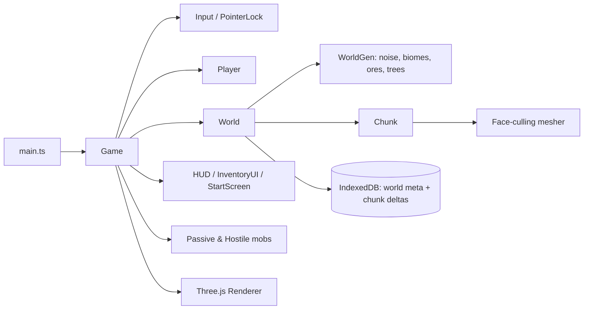

<p align="center">
  
</p>

<p align="center">
  
</p>

<p align="center">
  
  
  
  
  
</p>

<p align="center">
  
  <br/><sub>Real gameplay captured from this build in headless Chromium (software WebGL): walking, jumping, mining blocks and opening the inventory. Frame rate in the GIF is not representative.</sub>
</p>

## 📑 Table of contents

- [Overview](#-overview)
- [Features](#-features)
- [Demo and screenshots](#-demo-and-screenshots)
- [Architecture](#-architecture)
- [Tech stack](#-tech-stack)
- [Requirements](#-requirements)
- [Installation and configuration](#-installation-and-configuration)
- [Usage](#-usage)
- [Project structure](#-project-structure)
- [Testing](#-testing)
- [Troubleshooting and FAQ](#-troubleshooting-and-faq)
- [Roadmap](#-roadmap)
- [Contributing](#-contributing)
- [License](#-license)
- [Author](#-author)

## 🌍 Overview

**Problem:** voxel engines are a great way to learn real-time 3D, procedural generation and data-driven game design, but most tutorials stop at "render a few cubes".

**Solution:** Voxel Sandbox is a complete, small vertical slice that runs with zero backend. A text seed deterministically generates a world that is streamed in chunks, meshed with face culling, and edited by the player. Only the player's edits are persisted (as per-chunk deltas in IndexedDB), so saves stay tiny.

## ✨ Features

- **Procedural world** from a text seed: multi-octave simplex-noise heightmap, three biomes (plains, forest, desert), ore veins (coal/iron) and trees. The same seed always gives the same world.
- **Chunked streaming**: 16x64x16 chunks loaded in a radius around the player (view radius of 6 chunks) and unloaded when far away; meshes are rebuilt only for dirty chunks.
- **Face-culling mesher** that emits only exposed block faces, with per-face vertex colours.
- **First-person controls** with pointer lock, AABB collision, gravity, jumping and sprinting.
- **Mining and building** using a DDA voxel raycast and a target highlight box; broken blocks drop collectable items.
- **Inventory, hotbar and crafting** (planks, sticks, wooden pickaxe, hoe).
- **Farming**: till dirt with the hoe, plant seeds, crops grow through four stages on a deterministic seeded random tick.
- **Mobs**: passive wanderers and hostile mobs that chase the player at night.
- **Persistence**: only edited blocks are stored as per-chunk deltas in IndexedDB, together with player state, inventory and world time (press `K` to save, `beforeunload` also saves).

## 🎬 Demo and screenshots

| Start screen | Terrain | Inventory |
| --- | --- | --- |
|  |  |  |

## 🏗 Architecture



## 🧰 Tech stack

| Layer | Technology |
| --- | --- |
| Language | TypeScript 5.4 (`tsc` type-check in the build) |
| Rendering | Three.js 0.160 (WebGL) |
| Tooling | Vite 5 (dev server on port 5173) |
| World generation | `simplex-noise` + `alea` (seeded PRNG) |
| Storage | Browser IndexedDB (no server) |

## 📋 Requirements

| Item | Requirement |
| --- | --- |
| OS | Windows, macOS or Linux |
| Node.js | 18 or newer (verified with Node 24) with npm |
| Browser | Modern desktop browser with WebGL and Pointer Lock support (Chrome, Edge, Firefox) |
| Hardware | A GPU is recommended; software WebGL works but is slow |
| Ports | `5173` (Vite dev server) |
| Accounts / API keys | None |
| Disk | Roughly 150 MB including `node_modules` |

## 🔧 Installation and configuration

```bash
git clone https://github.com/ORD1STAR/voxel-sandbox.git
cd voxel-sandbox
npm install
npm run dev        # development server (Vite), http://localhost:5173
```

Production build:

```bash
npm run build      # type-check (tsc) + production build into dist/
npm run preview    # serve the production build
```

**Environment variables:** none. The project has no backend, no secrets and no configuration files to edit.

## 🎮 Usage

Open the printed local URL, type an optional seed, click **New World**, then click the canvas to capture the mouse.

| Input | Action |
| --- | --- |
| `W` `A` `S` `D` | Move |
| `Space` / `Shift` | Jump / sprint |
| Mouse | Look |
| Left click (hold) | Attack mob or break block |
| Right click | Place block / till with hoe / plant seeds |
| Mouse wheel | Change hotbar slot |
| `E` | Inventory and crafting |
| `K` | Save world |

## 🗂 Project structure

<details>
<summary>Show tree</summary>

```
src/
  engine/     Game loop, input, renderer, time
  world/      World, Chunk, generation/, meshing/, storage/ (IndexedDB + delta codec)
  entities/   Player, item drops, mobs/
  data/       Block, item and recipe definitions
  ui/         HUD, inventory/crafting UI, start screen
  utils/      AABB, hashing, RNG, voxel raycast
docs/         Screenshots and gameplay GIF
index.html    Vite entry
```

</details>

## 🧪 Testing

There is no automated test suite yet. `npm run build` runs the TypeScript compiler as a static check, and the screenshots and GIF above were produced by driving the real build in headless Chromium.

## 🛠 Troubleshooting and FAQ

<details>
<summary>The mouse does not move the camera</summary>

Click the canvas after starting a world: the browser only grants Pointer Lock after a user click. Press `Esc` to release it.
</details>

<details>
<summary>The game is very slow or the screen is black</summary>

Make sure hardware acceleration is enabled in your browser. Software WebGL renders the scene but at a low frame rate.
</details>

<details>
<summary>My world was lost</summary>

Saves live in the browser's IndexedDB for this origin (including the port). Press `K` to save explicitly; clearing site data or using another port or browser starts a fresh world.
</details>

<details>
<summary>`npm run build` fails on types</summary>

Run `npm install` again so the pinned `three` and `@types/three` versions are installed, and use Node 18+.
</details>

## 🗺 Roadmap

- [ ] Generate water (the block exists but is decorative and not generated) and enable caves in the generator
- [ ] True greedy meshing (the current mesher emits one quad per exposed face)
- [ ] Texture atlas and lighting
- [ ] Richer mob AI and day/night cycle
- [ ] Automated tests for generation determinism and the delta codec

## 🤝 Contributing

Issues and pull requests are welcome. Please keep `npm run build` passing and describe the gameplay or engine change in the PR.

## 📄 License

Released under the [MIT License](LICENSE).

## 👤 Author

<table>
  <tr>
    <td><b>Hannoun Amine Amar</b><br/>AI Engineer / Fullstack Developer, Algeria</td>
    <td>
      <a href="https://www.linkedin.com/in/hannoun-amine/"></a>
      <a href="https://github.com/ORD1STAR"></a>
      <a href="mailto:hannoun.amine25@gmail.com"></a>
    </td>
  </tr>
</table>

<p align="center">
  
</p>
